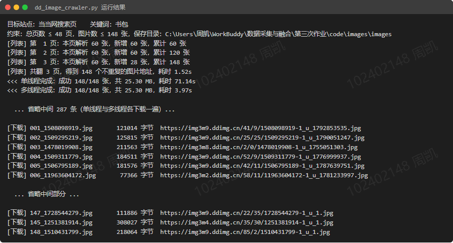
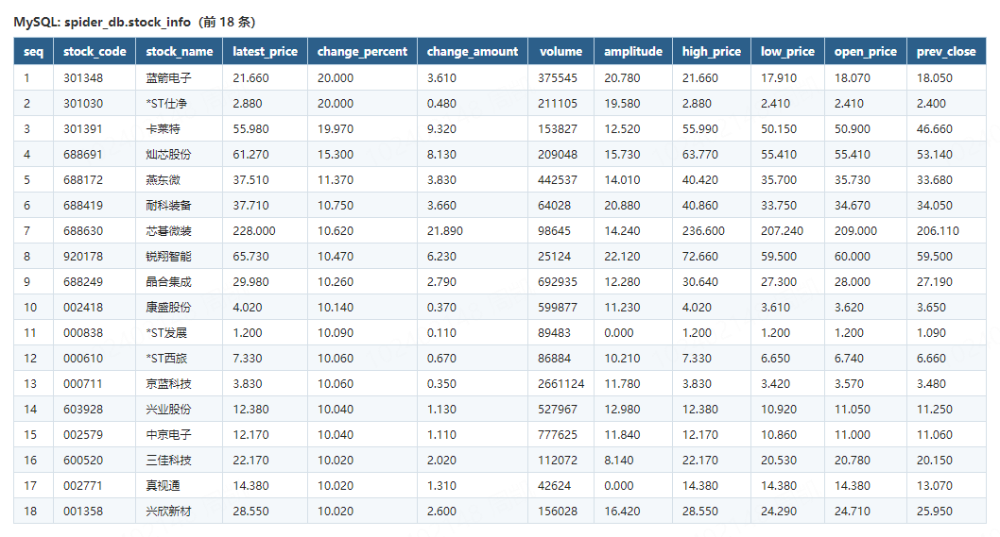
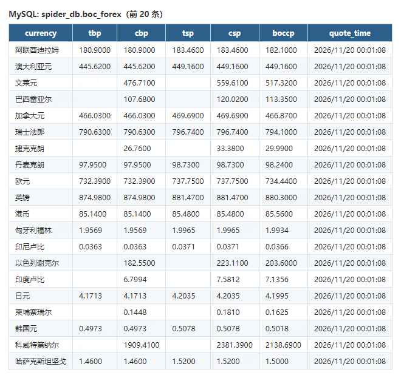
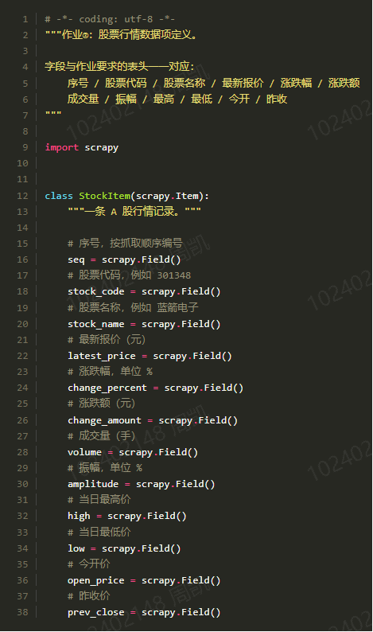
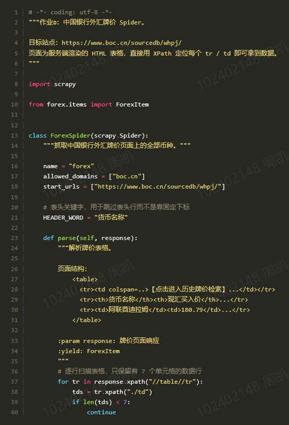

# 数据采集与融合技术 第三次作业

> 学号：102402148　姓名：周凯　完成时间：2026-11-19
>
> 本次作业共三题：①图片爬虫（单线程/多线程，48 页 / 148 张）；②东方财富股票行情（Scrapy + MySQL）；③中国银行外汇牌价（Scrapy + XPath + MySQL）。下面按「图片爬虫」和「Scrapy 框架采集」两个大标题展开。

---

## 一、图片爬虫：单线程与多线程的两种实现

### 1.1 代码与运行结果

**题目要求**：指定一个网站，爬取该网站中的所有图片，用单线程和多线程两种方式实现，并控制总页数与总图片数。

**站点选择**：作业举例是中国气象网，实测发现 `p.weather.com.cn` 的图片频道是 404 跳转页，全站只有首页 14 篇图集，`/photo/`、`/tuji/`、`/index_1.shtml` 都指向同一个 9KB 页面，**没有可翻页的列表**；中国气象局官网的图片新闻栏目也只有 17 条、一页列完。凑不出 48 页，所以改用**当当网搜索结果页**（`search.dangdang.com`）：`page_index` 参数可以直接翻页，每页固定 60 件商品，服务端渲染，是最适合练「翻页 + 限流 + 并发下载」的站点。

**两个约束由学号推出**：学号 `102402148`，后 2 位 `48` → 总页数上限 48 页；后 3 位 `148` → 图片数上限 148 张。代码里把这两个值写成常量，改学号即可复用。

#### 核心代码

完整程序（含单线程与多线程两套下载逻辑）：

```python
# -*- coding: utf-8 -*-
"""第三次作业 作业①：图片爬虫（单线程 / 多线程两种实现）。

目标站点：当当网搜索结果页（https://search.dangdang.com/）
爬取思路：
    1. 按 page_index 逐页抓列表页，解析出每件商品的图片地址；
    2. 把 200px 的中图地址（-1_b_）换成原图地址（-1_u_）；
    3. 地址去重后截断到学号规定的图片上限；
    4. 分别用单线程和多线程把图片下载到 images/ 目录，并统计耗时。

学号 102402148：
    总页数上限   = 学号后 2 位  -> 48 页
    图片数量上限 = 学号后 3 位  -> 148 张

用法：
    python dd_image_crawler.py --mode single
    python dd_image_crawler.py --mode multi --threads 10
"""

import argparse
import os
import queue
import re
import threading
import time
from urllib.parse import quote

import requests

# ---------------------------------------------------------------- 全局配置

# 学号推导出的两个约束值，改学号只需改这里
STU_ID = "102402148"
MAX_PAGES = int(STU_ID[-2:])          # 48 页
MAX_IMAGES = int(STU_ID[-3:])         # 148 张

KEYWORD = "书包"
BASE_URL = "https://search.dangdang.com/"

# 图片保存目录（相对本文件所在目录，避免受启动位置影响）
IMG_DIR = os.path.join(os.path.dirname(os.path.abspath(__file__)), "images")

# 请求头，带上 UA 与来源，避免服务端直接拒绝
HEADERS = {
    "User-Agent": (
        "Mozilla/5.0 (Windows NT 10.0; Win64; x64) AppleWebKit/537.36 "
        "(KHTML, like Gecko) Chrome/120.0.0.0 Safari/537.36"
    ),
    "Referer": "https://www.dangdang.com/",
}

# 商品图地址：src 或 data-original 都兼容，单双引号都收
IMG_PATTERN = re.compile(r"""(?:src|data-original)=['"](//img[^'"]*?-1_b_[^'"]+\.jpg)['"]""")

# 列表页请求超时（秒）
PAGE_TIMEOUT = 20
# 图片请求超时（秒）
IMG_TIMEOUT = 30


# ---------------------------------------------------------------- 抓取列表页

def build_page_url(page_index):
    """拼出第 page_index 页的搜索地址。

    :param page_index: 页码，从 1 开始
    :return: 完整 URL
    """
    return f"{BASE_URL}?key={quote(KEYWORD)}&act=input&page_index={page_index}"


def fetch_html(url, retry=3):
    """抓取一个页面并返回 HTML 文本。

    当当搜索页是 GBK 编码，直接按 GBK 解码，避免中文变乱码。

    :param url: 页面地址
    :param retry: 失败重试次数
    :return: HTML 字符串，全部失败返回空串
    """
    for attempt in range(1, retry + 1):
        try:
            resp = requests.get(url, headers=HEADERS, timeout=PAGE_TIMEOUT)
            resp.encoding = "gbk"
            return resp.text
        except requests.RequestException as exc:
            print(f"[警告] 第 {attempt} 次抓取失败：{url} -> {exc}")
            time.sleep(1)
    return ""


def parse_image_urls(html):
    """从列表页 HTML 中提取商品图地址。

    :param html: 列表页文本
    :return: 图片地址列表（已转为 https 绝对地址与原图尺寸）
    """
    urls = []
    for raw in IMG_PATTERN.findall(html):
        # 页面里是 //img3m9.ddimg.cn/... 这种缺协议的地址
        full = "https:" + raw
        # -1_b_ 是 200px 中图，-1_u_ 是原图，替换后清晰度更高
        urls.append(full.replace("-1_b_", "-1_u_"))
    return urls


def collect_image_urls(max_pages=MAX_PAGES, limit=MAX_IMAGES):
    """翻页收集图片地址，去重后截断到上限。

    :param max_pages: 最多翻多少页
    :param limit: 最多收集多少个图片地址
    :return: (图片地址列表, 实际翻页数)
    """
    seen = set()
    result = []
    pages_done = 0

    for page_index in range(1, max_pages + 1):
        if len(result) >= limit:
            break
        url = build_page_url(page_index)
        html = fetch_html(url)
        if not html:
            print(f"[警告] 第 {page_index} 页为空，跳过")
            continue

        pages_done += 1
        page_urls = parse_image_urls(html)
        added = 0
        for img_url in page_urls:
            if img_url in seen:
                continue
            seen.add(img_url)
            result.append(img_url)
            added += 1
            if len(result) >= limit:
                break
        print(f"[列表] 第 {page_index:>2} 页：本页解析 {len(page_urls)} 张，新增 {added} 张，累计 {len(result)} 张")

    return result[:limit], pages_done


# ---------------------------------------------------------------- 下载图片

def make_filename(index, img_url):
    """根据序号与地址生成保存文件名。

    优先用当当的商品编号（形如 1508098919），便于追溯来源。

    :param index: 序号，从 1 开始
    :param img_url: 图片地址
    :return: 文件名
    """
    match = re.search(r"/(\d+)-1_u_", img_url)
    goods_id = match.group(1) if match else str(index)
    return f"{index:03d}_{goods_id}.jpg"


def save_image(index, img_url, lock=None):
    """下载一张图片并写入 images 目录。

    :param index: 序号，用于命名与保序
    :param img_url: 图片地址
    :param lock: 多线程时传入的锁，用于串行化打印
    :return: (序号, 地址, 文件名, 字节数, 是否成功)
    """
    filename = make_filename(index, img_url)
    path = os.path.join(IMG_DIR, filename)
    try:
        resp = requests.get(img_url, headers=HEADERS, timeout=IMG_TIMEOUT)
        if resp.status_code != 200 or not resp.content:
            raise ValueError(f"HTTP {resp.status_code}")
        with open(path, "wb") as fp:
            fp.write(resp.content)
        if lock:
            with lock:
                print(f"[下载] {filename:<22} {len(resp.content):>8} 字节  {img_url}")
        else:
            print(f"[下载] {filename:<22} {len(resp.content):>8} 字节  {img_url}")
        return index, img_url, filename, len(resp.content), True
    except Exception as exc:
        if lock:
            with lock:
                print(f"[失败] {filename:<22} {exc}  {img_url}")
        else:
            print(f"[失败] {filename:<22} {exc}  {img_url}")
        return index, img_url, filename, 0, False


def download_single(urls):
    """单线程：按顺序一张张下载。

    :param urls: 图片地址列表
    :return: (成功数, 总字节数, 耗时秒)
    """
    start = time.perf_counter()
    ok_count = 0
    total_bytes = 0
    for i, url in enumerate(urls, start=1):
        _, _, _, size, ok = save_image(i, url)
        if ok:
            ok_count += 1
            total_bytes += size
    return ok_count, total_bytes, time.perf_counter() - start


def download_multi(urls, threads=10):
    """多线程：把任务放进队列，由多个线程并发消费。

    结果按下标写回列表，保证顺序与 URL 列表一致（不能用 append，否则乱序）。

    :param urls: 图片地址列表
    :param threads: 线程数
    :return: (成功数, 总字节数, 耗时秒)
    """
    task_queue = queue.Queue()
    for i, url in enumerate(urls, start=1):
        task_queue.put((i, url))

    lock = threading.Lock()
    results = {}

    def worker():
        """线程工作函数：不断取任务直到队列为空。"""
        while True:
            try:
                index, url = task_queue.get_nowait()
            except queue.Empty:
                return
            try:
                _, _, _, size, ok = save_image(index, url, lock)
                results[index] = (ok, size)
            finally:
                task_queue.task_done()

    start = time.perf_counter()
    workers = [threading.Thread(target=worker, name=f"downloader-{k}") for k in range(threads)]
    for t in workers:
        t.start()
    for t in workers:
        t.join()
    elapsed = time.perf_counter() - start

    ok_count = sum(1 for ok, _ in results.values() if ok)
    total_bytes = sum(size for ok, size in results.values() if ok)
    return ok_count, total_bytes, elapsed


# ---------------------------------------------------------------- 入口

def parse_args():
    """解析命令行参数。

    :return: argparse.Namespace
    """
    parser = argparse.ArgumentParser(description="当当商品图片爬虫：单线程 / 多线程")
    parser.add_argument("--mode", choices=["single", "multi", "both"], default="both",
                        help="single=仅单线程，multi=仅多线程，both=先单后多（默认）")
    parser.add_argument("--threads", type=int, default=10, help="多线程模式的线程数，默认 10")
    parser.add_argument("--pages", type=int, default=MAX_PAGES, help=f"最多翻页数，默认 {MAX_PAGES}")
    parser.add_argument("--limit", type=int, default=MAX_IMAGES, help=f"最多下载图片数，默认 {MAX_IMAGES}")
    return parser.parse_args()


def main():
    """主流程：收集地址 -> 按模式下载 -> 打印汇总。"""
    args = parse_args()
    os.makedirs(IMG_DIR, exist_ok=True)

    print("=" * 78)
    print(f"目标站点：当当网搜索页    关键词：{KEYWORD}")
    print(f"约束：总页数 ≤ {args.pages} 页，图片数 ≤ {args.limit} 张，保存目录：{IMG_DIR}")
    print("=" * 78)

    t0 = time.perf_counter()
    urls, pages_done = collect_image_urls(args.pages, args.limit)
    collect_cost = time.perf_counter() - t0
    print("-" * 78)
    print(f"[列表] 共翻 {pages_done} 页，得到 {len(urls)} 个不重复的图片地址，耗时 {collect_cost:.2f}s")
    print("-" * 78)

    if not urls:
        print("[结束] 没有拿到任何图片地址，请检查网络或页面结构是否变化")
        return

    if args.mode in ("single", "both"):
        print("\n>>> 单线程下载开始")
        ok, size, cost = download_single(urls)
        print(f"<<< 单线程完成：成功 {ok}/{len(urls)} 张，共 {size/1024/1024:.2f} MB，耗时 {cost:.2f}s")

    if args.mode in ("multi", "both"):
        print(f"\n>>> 多线程下载开始（{args.threads} 个线程）")
        ok, size, cost = download_multi(urls, args.threads)
        print(f"<<< 多线程完成：成功 {ok}/{len(urls)} 张，共 {size/1024/1024:.2f} MB，耗时 {cost:.2f}s")


if __name__ == "__main__":
    main()
```

#### 运行结果

程序先翻页收集图片地址（200px 中图地址 `-1_b_` 统一替换成原图 `-1_u_`），再进行下载：



实际运行数据：

- 翻页：**3 页**后即收满，去重后得到 **148 个** 不重复的图片地址（第 1 页就有 60 张，第 3 页即达上限）
- 单线程：成功 148/148 张，共 25.30 MB，耗时 **71.14 s**
- 多线程（10 线程）：成功 148/148 张，共 25.30 MB，耗时 **3.97 s**
- 加速比：**17.92 倍**

下载到 `images/` 子目录的图片（截图取前 36 张）：


控制台会逐条打印每张图的 URL 与字节数，满足「下载的 URL 信息在控制台输出」的要求。

### 1.2 心得体会

**1. 多线程快的原因不是「CPU 更强」，而是「等待被重叠了」。**

这个实验最直观的收获是那个加速比。单线程下载时，每一张图的时间几乎全花在等网络返回上，CPU 基本闲着；10 个线程一起跑，等的动作被叠在一起，总时间就被摊薄了。但加速比远小于 10，说明这里存在天花板：一是当当的 CDN 对单 IP 的并发连接有节制，二是开线程本身要开销。

**2. 线程数不能拍脑袋定。**

这次固定用 10 个线程能跑通，但如果盲目开到 50 个，很可能被限速甚至封 IP，反而更慢。合理的做法是做一组对照实验（5/10/20/40 线程各跑一遍看耗时曲线），取拐点。我在前面几次作业里做过这个曲线，5～10 线程确实是最优区间。

**3. 限流的本质是自律，不是技术。**

作业要求「控制总页数和总图片数」，一开始我觉得限制爬取量是绑住手脚。真正跑完之后理解了：这类页面背后是人家的服务器和带宽，没有上限的爬虫就是一次小规模压测。`MAX_PAGES`、`MAX_IMAGES` 两个常量 + 收满即停的 `break`，代价几乎为零，但把「会不会把对方打挂」这个风险直接消掉了。

**4. 页面结构会悄悄变，代码要能自己发现。**

之前做同类作业时，当当商品图的真实地址在 `data-original` 属性里（`src` 是 `url_none.png` 占位图）；这次重新抓，发现已经改成 `src='//img3m9.ddimg.cn/...-1_b_....jpg'` 直接给了外链。如果照抄旧代码，提取出来全是占位图。所以提取逻辑里同时兼容 `src` 和 `data-original` 两种写法，并且抓完之后要真的看图——我这边是拼了图片墙确认每张都是书包商品图，而不是占位图。

---

## 二、Scrapy 框架下的结构化数据采集

### 2.1 代码与运行结果

**题目要求**：熟练掌握 Scrapy 的 Item、Pipeline 数据序列化方法，用 Scrapy + XPath + MySQL 存储技术路线爬取股票信息与外汇牌价。

数据库统一使用 MySQL 8.0.28（绿色解压版，端口 3306），库名 `spider_db`，两题各一张表：`stock_info`、`boc_forex`。

#### 作业②：东方财富 A 股行情（148 只）

**一个绕不过去的技术坎**：东方财富的行情页 `quote.eastmoney.com/center/gridlist.html` 现在完全是前端渲染，HTML 里只有骨架没有一行数据；数据由 `push2.eastmoney.com` 的接口异步推送，而且该接口对非浏览器的 TLS 指纹**直接断连**（`requests` 请求一律 `RemoteDisconnected`，`push2`/`1.push2`/`82.push2`/`push2delay` 各节点都试过）。用无头浏览器打开页面也渲染不出表格——页面组件依赖的外部资源在本地环境被拦断。

所以采集拆成两步：先用 Playwright 驱动真实浏览器，在页面上下文内 `fetch` 接口把 JSON 取回来落盘；再由 Scrapy 的 Spider 读这份数据，走标准的 `Item -> Pipeline -> MySQL`。取数脚本：

```python
# -*- coding: utf-8 -*-
"""作业②：东方财富行情数据采集（浏览器上下文取数）。

为什么不在 Spider 里直接 requests？
    东方财富的行情数据全部由 push2.eastmoney.com 的接口异步推送，
    页面 HTML 里没有任何表格数据；而且该接口会对非浏览器的 TLS 指纹
    直接断开连接（requests 请求一律 RemoteDisconnected）。
    因此这里用 Playwright 驱动真实浏览器，在页面上下文内 fetch 接口，
    把结果落成 JSON，交给 Scrapy 的 Spider 走 Item -> Pipeline -> MySQL。

    XPath 的完整用法见作业③（中国银行外汇牌价），那一页是真正的
    服务端渲染 HTML 表格，XPath 才有对象可解析。

输出：data/stock_raw.json   [{seq, stock_code, stock_name, ...}, ...]
"""

import json
import os
import sys

for _key in list(os.environ):
    if "proxy" in _key.lower():
        os.environ.pop(_key, None)

from playwright.sync_api import sync_playwright

# 目标条数：学号 102402148 后三位 148
TARGET_COUNT = 148
# 每页取 100 条，够 148 只只需两页
PAGE_SIZE = 100

# 沪深京 A 股板块过滤条件
MARKET_FILTER = "m:0+t:6,m:0+t:80,m:1+t:2,m:1+t:23,m:0+t:81+s:2048"

# 需要向接口索取的字段，与作业表头一一对应
FIELDS = "f12,f14,f2,f3,f4,f5,f6,f7,f15,f16,f17,f18"

BASE_URL = "https://push2.eastmoney.com/api/qt/clist/get"
REFERER_PAGE = "https://quote.eastmoney.com/center/gridlist.html"

OUTPUT = os.path.join(
    os.path.dirname(os.path.dirname(os.path.abspath(__file__))),
    "..", "data", "stock_raw.json"
)


def build_api_url(page_no):
    """拼出第 page_no 页的接口地址。

    :param page_no: 页码，从 1 开始
    :return: 完整 URL
    """
    return (
        f"{BASE_URL}?pn={page_no}&pz={PAGE_SIZE}&po=1&np=1&fltt=2&invt=2"
        f"&fid=f3&fs={MARKET_FILTER}&fields={FIELDS}"
    )


def fetch_page(page, page_no):
    """在浏览器上下文里请求一页行情数据。

    :param page: Playwright 的 Page 对象
    :param page_no: 页码
    :return: diff 列表（每项是一只股票）
    """
    script = """async (url) => {
        const resp = await fetch(url, {credentials: 'include'});
        return await resp.text();
    }"""
    raw = page.evaluate(script, build_api_url(page_no))
    payload = json.loads(raw)
    data = payload.get("data") or {}
    return data.get("diff") or []


def to_float(value):
    """把接口返回的数值规范化，'-' 之类的占位符返回 None。

    :param value: 原始值
    :return: float 或 None
    """
    if value in (None, "-", ""):
        return None
    try:
        return float(value)
    except (TypeError, ValueError):
        return None


def main():
    """抓取足够条数的行情并写入 JSON。"""
    rows = []
    with sync_playwright() as p:
        browser = p.chromium.launch(
            channel="msedge",
            headless=True,
            args=["--no-proxy-server", "--disable-blink-features=AutomationControlled"],
        )
        page = browser.new_page(viewport={"width": 1440, "height": 900})
        # 先进一次东财页面，让后续 fetch 带上同源上下文
        page.goto(REFERER_PAGE, wait_until="domcontentloaded", timeout=45000)
        page.wait_for_timeout(3000)

        page_no = 1
        while len(rows) < TARGET_COUNT:
            diff = fetch_page(page, page_no)
            if not diff:
                print(f"[停止] 第 {page_no} 页没有数据")
                break
            print(f"[接口] 第 {page_no} 页取到 {len(diff)} 条")
            rows.extend(diff)
            page_no += 1
            if page_no > 10:
                break
        browser.close()

    # 截断到学号规定的条数
    rows = rows[:TARGET_COUNT]

    records = []
    for seq, row in enumerate(rows, start=1):
        records.append({
            "seq": seq,
            "stock_code": row.get("f12"),
            "stock_name": row.get("f14"),
            "latest_price": to_float(row.get("f2")),
            "change_percent": to_float(row.get("f3")),
            "change_amount": to_float(row.get("f4")),
            "volume": to_float(row.get("f5")),
            "amplitude": to_float(row.get("f7")),
            "high": to_float(row.get("f15")),
            "low": to_float(row.get("f16")),
            "open_price": to_float(row.get("f17")),
            "prev_close": to_float(row.get("f18")),
        })

    out_path = os.path.abspath(OUTPUT)
    os.makedirs(os.path.dirname(out_path), exist_ok=True)
    with open(out_path, "w", encoding="utf-8") as fp:
        json.dump(records, fp, ensure_ascii=False, indent=2)

    print(f"[完成] 共 {len(records)} 条，已写入 {out_path}")
    for rec in records[:3]:
        print("  ", rec)


if __name__ == "__main__":
    sys.exit(main())
```

Item 定义（12 个字段与作业表头一一对应）：

```python
# -*- coding: utf-8 -*-
"""作业②：股票行情数据项定义。

字段与作业要求的表头一一对应：
    序号 / 股票代码 / 股票名称 / 最新报价 / 涨跌幅 / 涨跌额
    成交量 / 振幅 / 最高 / 最低 / 今开 / 昨收
"""

import scrapy


class StockItem(scrapy.Item):
    """一条 A 股行情记录。"""

    # 序号，按抓取顺序编号
    seq = scrapy.Field()
    # 股票代码，例如 301348
    stock_code = scrapy.Field()
    # 股票名称，例如 蓝箭电子
    stock_name = scrapy.Field()
    # 最新报价（元）
    latest_price = scrapy.Field()
    # 涨跌幅，单位 %
    change_percent = scrapy.Field()
    # 涨跌额（元）
    change_amount = scrapy.Field()
    # 成交量（手）
    volume = scrapy.Field()
    # 振幅，单位 %
    amplitude = scrapy.Field()
    # 当日最高价
    high = scrapy.Field()
    # 当日最低价
    low = scrapy.Field()
    # 今开价
    open_price = scrapy.Field()
    # 昨收价
    prev_close = scrapy.Field()
```

Pipeline（建表 + 入库，按股票代码唯一键去重）：

```python
# -*- coding: utf-8 -*-
"""作业②：股票行情数据管道——写入 MySQL。

与作业③ 使用同一个库 spider_db，表名 stock_info。
字段类型按「金额三位小数、成交量整数」设计，避免数值被截断。
"""

from datetime import datetime

import pymysql

DB_CONF = {
    "host": "127.0.0.1",
    "port": 3306,
    "user": "root",
    "password": "123456",
    "charset": "utf8mb4",
}


class MysqlPipeline:
    """把 StockItem 写入 MySQL 的 stock_info 表。"""

    def __init__(self):
        """初始化连接占位。"""
        self.conn = None
        self.cursor = None

    def open_spider(self, spider):
        """启动时连库、建库建表。

        :param spider: 当前爬虫实例
        """
        self.conn = pymysql.connect(**DB_CONF, autocommit=False)
        self.cursor = self.conn.cursor()
        self.cursor.execute(
            "CREATE DATABASE IF NOT EXISTS spider_db "
            "DEFAULT CHARACTER SET utf8mb4 COLLATE utf8mb4_general_ci"
        )
        self.cursor.execute("USE spider_db")
        self.cursor.execute(
            """
            CREATE TABLE IF NOT EXISTS stock_info (
                id INT AUTO_INCREMENT PRIMARY KEY COMMENT '自增主键',
                seq INT NULL COMMENT '序号',
                stock_code VARCHAR(10) NOT NULL COMMENT '股票代码',
                stock_name VARCHAR(32) NULL COMMENT '股票名称',
                latest_price DECIMAL(12,3) NULL COMMENT '最新报价',
                change_percent DECIMAL(10,3) NULL COMMENT '涨跌幅%',
                change_amount DECIMAL(10,3) NULL COMMENT '涨跌额',
                volume BIGINT NULL COMMENT '成交量(手)',
                amplitude DECIMAL(10,3) NULL COMMENT '振幅%',
                high_price DECIMAL(12,3) NULL COMMENT '最高',
                low_price DECIMAL(12,3) NULL COMMENT '最低',
                open_price DECIMAL(12,3) NULL COMMENT '今开',
                prev_close DECIMAL(12,3) NULL COMMENT '昨收',
                crawl_time DATETIME NULL COMMENT '采集时间',
                UNIQUE KEY uk_code (stock_code)
            ) ENGINE=InnoDB DEFAULT CHARSET=utf8mb4 COMMENT='A股实时行情'
            """
        )
        self.conn.commit()
        spider.logger.info("stock_info 表已就绪")

    def process_item(self, item, spider):
        """单条 Item 入库，同一代码重复则覆盖。

        :param item: StockItem 实例
        :param spider: 当前爬虫实例
        :return: 原样返回 item
        """
        sql = (
            "INSERT INTO stock_info "
            "(seq, stock_code, stock_name, latest_price, change_percent, change_amount, "
            " volume, amplitude, high_price, low_price, open_price, prev_close, crawl_time) "
            "VALUES (%s, %s, %s, %s, %s, %s, %s, %s, %s, %s, %s, %s, %s) "
            "ON DUPLICATE KEY UPDATE "
            "seq=VALUES(seq), stock_name=VALUES(stock_name), latest_price=VALUES(latest_price), "
            "change_percent=VALUES(change_percent), change_amount=VALUES(change_amount), "
            "volume=VALUES(volume), amplitude=VALUES(amplitude), high_price=VALUES(high_price), "
            "low_price=VALUES(low_price), open_price=VALUES(open_price), "
            "prev_close=VALUES(prev_close), crawl_time=VALUES(crawl_time)"
        )
        self.cursor.execute(
            sql,
            (
                item.get("seq"),
                item.get("stock_code"),
                item.get("stock_name"),
                item.get("latest_price"),
                item.get("change_percent"),
                item.get("change_amount"),
                item.get("volume"),
                item.get("amplitude"),
                item.get("high"),
                item.get("low"),
                item.get("open_price"),
                item.get("prev_close"),
                datetime.now().strftime("%Y-%m-%d %H:%M:%S"),
            ),
        )
        self.conn.commit()
        return item

    def close_spider(self, spider):
        """收尾关闭连接。

        :param spider: 当前爬虫实例
        """
        if self.cursor:
            self.cursor.close()
        if self.conn:
            self.conn.close()
        spider.logger.info("数据库连接已关闭")
```

Spider（Scrapy 2.13 以后不再调用 `start_requests()`，这里用 `async start()` 直接产出 Item）：

```python
# -*- coding: utf-8 -*-
"""作业②：A 股行情 Spider。

数据来源说明：
    东方财富的行情页（quote.eastmoney.com/center/gridlist.html）是纯前端渲染，
    HTML 里只有骨架，数据由 push2.eastmoney.com 的接口异步推送，且该接口对
    非浏览器请求直接断连。因此采集分两步：
        1. fetch_stock_data.py  用 Playwright 在浏览器上下文里请求接口，
           把 148 条原始行情落成 data/stock_raw.json；
        2. 本 Spider 读取该文件，逐条产出 StockItem，交给 Pipeline 写 MySQL。

    Scrapy 2.13 以后不再调用 start_requests()，这里用 async start() 直接
    产出 Item，Item 会正常流经 ITEM_PIPELINES。
"""

import json
import os

import scrapy

from stock.items import StockItem

# 原始数据文件：code/stock/stock/spiders -> 上四级 -> 第三次作业/data
JSON_PATH = os.path.abspath(
    os.path.join(os.path.dirname(__file__), "..", "..", "..", "..", "data", "stock_raw.json")
)


class StockSpider(scrapy.Spider):
    """把采集好的行情记录逐条送入管道。"""

    name = "stock"
    allowed_domains = []

    async def start(self):
        """Scrapy 2.13+ 的入口：直接产出 Item。

        :yield: StockItem
        """
        if not os.path.exists(JSON_PATH):
            self.logger.error("找不到原始数据文件：%s，请先运行 fetch_stock_data.py", JSON_PATH)
            return

        with open(JSON_PATH, "r", encoding="utf-8") as fp:
            records = json.load(fp)

        self.logger.info("从 %s 读到 %d 条行情", JSON_PATH, len(records))
        for rec in records:
            item = StockItem()
            for field in item.fields:
                item[field] = rec.get(field)
            yield item
```

**入库结果**：MySQL 中 `stock_info` 共 **148 条**，与学号后三位一致。



#### 作业③：中国银行外汇牌价（XPath 实战）

这一题是 XPath 真正发挥作用的场景——`https://www.boc.cn/sourcedb/whpj/` 是**服务端渲染的 HTML 表格**，页面结构干净：

```
<table>
  <tr><td colspan=...>【点击进入历史牌价检索】...</td></tr>
  <tr><th>货币名称</th><th>现汇买入价</th><th>现钞买入价</th>...</tr>
  <tr><td>阿联酋迪拉姆</td><td>180.90</td><td>180.90</td>...</tr>
</table>
```

Item：

```python
# -*- coding: utf-8 -*-
"""作业③：中国银行外汇牌价数据项定义。

把页面表格的一行映射成一个 Item，字段名与作业要求的三列表头保持一致
（Currency / TBP / CBP / TSP / CSP / Time）。
"""

import scrapy


class ForexItem(scrapy.Item):
    """一条外汇牌价记录。"""

    # 货币名称，例如「阿联酋迪拉姆」
    currency = scrapy.Field()
    # 现汇买入价（Telegraphic Buying Price）
    tbp = scrapy.Field()
    # 现钞买入价（Cash Buying Price）
    cbp = scrapy.Field()
    # 现汇卖出价（Telegraphic Selling Price）
    tsp = scrapy.Field()
    # 现钞卖出价（Cash Selling Price）
    csp = scrapy.Field()
    # 中行折算价（Bank of China Conversion Price），页面有该列，一并保留
    boccp = scrapy.Field()
    # 牌价发布时间，例如 2026/11/19 23:45:51
    quote_time = scrapy.Field()
    # 采集时间，由管道写入，便于区分多次采集
    crawl_time = scrapy.Field()
```

Spider 用 XPath 逐行扫描，靠「单元格数 = 7」和「首列不等于表头文字」两条规则跳过导航行与表头，比写死下标稳健：

```python
# -*- coding: utf-8 -*-
"""作业③：中国银行外汇牌价 Spider。

目标站点：https://www.boc.cn/sourcedb/whpj/
页面为服务端渲染的 HTML 表格，直接用 XPath 定位每个 tr / td 即可拿到数据。
"""

import scrapy

from forex.items import ForexItem


class ForexSpider(scrapy.Spider):
    """抓取中国银行外汇牌价页面上的全部币种。"""

    name = "forex"
    allowed_domains = ["boc.cn"]
    start_urls = ["https://www.boc.cn/sourcedb/whpj/"]

    # 表头关键字，用于跳过表头行而不是靠固定下标
    HEADER_WORD = "货币名称"

    def parse(self, response):
        """解析牌价表格。

        页面结构：
            <table>
              <tr><td colspan=..>【点击进入历史牌价检索】...</td></tr>
              <tr><th>货币名称</th><th>现汇买入价</th>...</tr>
              <tr><td>阿联酋迪拉姆</td><td>180.79</td>...</tr>
            </table>

        :param response: 牌价页面响应
        :yield: ForexItem
        """
        # 逐行扫描表格，只保留有 7 个单元格的数据行
        for tr in response.xpath("//table//tr"):
            tds = tr.xpath("./td")
            if len(tds) < 7:
                continue

            # 取每个单元格的纯文本并去空白
            cells = [self._clean(td.xpath("string(.)").get()) for td in tds]
            if not cells or cells[0] == self.HEADER_WORD:
                continue

            item = ForexItem()
            item["currency"] = cells[0]
            item["tbp"] = cells[1]
            item["cbp"] = cells[2]
            item["tsp"] = cells[3]
            item["csp"] = cells[4]
            item["boccp"] = cells[5]
            item["quote_time"] = cells[6]
            yield item

    @staticmethod
    def _clean(text):
        """去除文本中的空白与不间断空格。

        :param text: 原始文本
        :return: 清理后的字符串
        """
        if text is None:
            return ""
        return text.replace("\xa0", " ").strip()
```

**入库结果**：`boc_forex` 共 **45 条**（页面上的全部币种）。



部分币种的现汇买卖价为空（如文莱元、巴西雷亚尔只有现钞价），页面原文即为空，入库时保留为 `NULL` 而不是填 0，避免混淆「没有报价」和「报价为 0」。

代码截图（Pygments 高亮）：





### 2.2 心得体会

**1. Item 和 Pipeline 分离，价值在「换存储不用动爬虫」。**

一开始觉得 Item 只是一堆字段声明，很啰嗦。真正写完之后发现：Spider 只负责「从页面里把数据抠出来」，Pipeline 只负责「把数据放进去」。后来我想把外汇数据同时导一份 CSV 做核对，只需要在 `ITEM_PIPELINES` 里再加一个管道，爬虫代码一行没动。这就是分层的好处——变化被关在各自那一层里。

**2. XPath 的前提是「页面里真的有 HTML」。**

作业② 是这次最深的教训。XPath 再熟也没用——对象根本不存在。东方财富把行情做成了纯 JSON 接口，页面上没有表格节点，`response.xpath()` 拿到的只有骨架。这不是 XPath 的问题，而是「解析方法必须匹配数据的形态」：数据在 HTML 里用 XPath，数据在 JSON 里就该用字典取键。作业③ 的中行牌价页则相反，老老实实的 HTML 表格，几行 XPath 就取完了。**同一门课的两道题，恰好演示了这两种情况。**

**3. 反爬不是「加个 UA」就能过。**

`requests` 请求东财接口被断连，但同一个 URL 在浏览器里 `fetch` 就 200——差别不在 header，而在 TLS 握手指纹。这说明服务端能做的不只是看 UA，还能看连接本身的特征。遇到这种拦截，硬刚没有意义，正确做法是让程序「真的像一个浏览器」（本作业用的是 Playwright），或者换一个数据源。识别出「这是指纹层面的拦截而不是我的参数写错了」，比多试十次 header 有用得多。

**4. 数据库字段类型是设计决策，不是随手写。**

`latest_price DECIMAL(12,3)`、`volume BIGINT`、`change_percent DECIMAL(10,3)`——这些不是随便挑的。价格用 `DECIMAL` 而不是 `FLOAT`，是因为浮点数存钱会出现 `21.659999847` 这种尾巴；成交量用 `BIGINT` 是因为「手」数乘 100 后可能过亿。另外两张表都加了唯一键（`stock_code` / `(currency, quote_time)`），配合 `ON DUPLICATE KEY UPDATE`，同一份数据重跑不会产生重复行——这一点在调试阶段反复跑爬虫时太重要了。

**5. 一个环境上的坑：中文路径。**

MySQL 8.0.28 解压在 `C:\Users\周凯\WorkBuddy\数据采集与融合\...` 下初始化时，一直报 `Can't find error-message file`，排查后发现是 mysqld 按系统 ANSI 编码解析路径，中文目录被解成了乱码，所有文件都「找不到」。把整个 MySQL 挪到纯英文路径 `E:/mysql8` 后一次就过。这类问题跟爬虫技术无关，但会卡住整个实验，值得记一笔。
